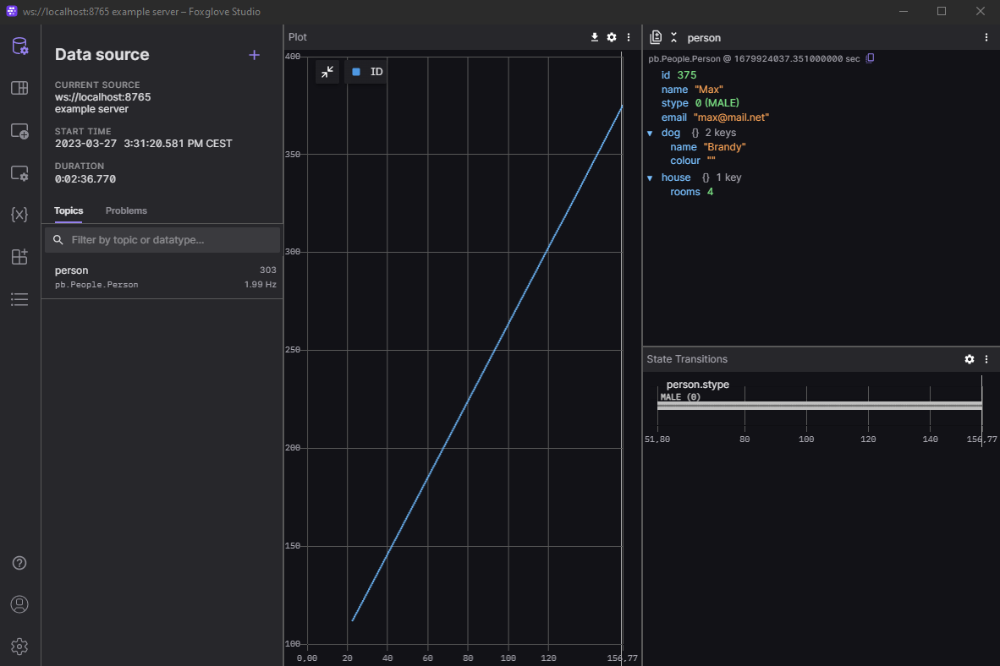

# eCAL Foxglove Bridge

This repository provides a server implementations to connect a network of eCAL tasks to the [Foxglove Studio](https://foxglove.dev/studio) visualization solution.
Foxglove Studio allows to provide data via a websocket connection.
This repository provides an implementation to forward arbitrary eCAL (Protobuf) traffic to be available for the wide selection of Foxglove panels.

## Installation instructions

For installation, you will need a recent Python version (>= 3.8).
We recommend to setup the Bridge in an isolated Python environment.

### eCAL 6 usage

Install the bridge via

```
pip install ecal-foxglove-bridge[with-eclipse-ecal]
```

### eCAL 5 usage

eCAL 5 is not available via pip, thus, it must be inatlled manually.
Please download the Python wheel matching to your eCAL installation and OS from the [Github Release Page](https://github.com/eclipse-ecal/ecal/releases).
Then install first the ecal5 wheel, and then the ecal_foxglove_bridge.
```
pip install /path/to/ecal5-wheel.whl
pip install ecal-foxglove-bridge
```

### Manually building the wheel

The package can also be build directly from the source code by executing
```
python -m build
```

The resulting .whl will be created in a dist folder and can be install manually via pip.


## Usage

After installing all requirements, the bridge can be launched by running

```
ecal-foxglove-bridge
```

Then run Foxglove Studio and a set of eCAL tasks, whose outputs you would like to visualize.
In Foxglove Studio, connect to a Websocket on the default port as a datasource.
You can use any of the available panels to visualize the data.



Beware that some panels (like the image visualization panel or the 3D panel) can only display specific message types.
However, Foxglove provides Protobuf `.proto` definition files for those messages, see [here](https://github.com/foxglove/schemas/tree/main/schemas/proto/foxglove).

### Blacklist

Use the `--blacklist` argument to specify a json file to blacklist topic names from beeing forwarded.
Default is `blacklist.json` file.
Add the topic names as a list. For example:
```json
[
  "foxglove_rm_road_bev",
  "foxglove_rm_lane_bev"
]
```

## Behind the scenes

eCAL Foxglove bridge uses the eCAL monitoring layer, to get meta information about data being published in the eCAL network.
This means that the names of the avaiable topics, as well as their types are forwarded to Foxglove.
Once Foxglove knows about the topics, they can be chosen to be displayed in the respective panels.
Only when the user chooses to visualize a specific topic, this information is transported back to the Bridge application.
It can then create eCAL subscribers for the requested data and forward it to Studio.

## Known limitations

### Bandwith of the websocket connection
~~The bandwidth of the Websocket connection is significantly slower that eCALs (SHM) bandwidth.
Especially when trying to visualize big, high frequency data, this can be problematic.
In order not to lag behind in case of overload, the Bridge application uses an internal queue with a fixed size.
Hence, messages might be dropped if they cannot be sent fast enough.~~
After deactivating compression in the websocket connection as a default, the connection seems fine. Make sure to upgrade the `foxglove-websocket` Python dependency to the newest version (>=0.1.1).

